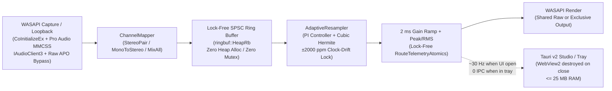

<p align="center">
  <picture>
    <source media="(prefers-color-scheme: dark)" srcset="./brand/uncord-lockup-dark.svg">
    <source media="(prefers-color-scheme: light)" srcset="./brand/uncord-lockup-color.svg">
    
  </picture>
</p>

# uncord

**Direct Windows audio routing without virtual cable clutter.**

Open-source, low-latency multi-route Windows WASAPI audio router with `<= 12 ms` software pipeline latency, adaptive clock-drift resampling, multi-channel USB-C splitting, a headless CLI daemon, and a `<= 25 MB` tray desktop studio.

[](LICENSE)
[](#quick-start)
[](#latency-breakdown-software-pipeline-vs-physical-transport)
[](#core-architecture)

English | [Türkçe](./README.tr.md) · [Agent Architecture Guide](./AGENTS.md) · [Brand Guidelines](./brand/BRAND_GUIDELINES.md) · [Changelog](./CHANGELOG.md)

---

## Why uncord?

Windows includes a built-in **"Listen to this device"** checkbox, but it lacks per-channel extraction, exposes no latency controls, drifts when bridging two independent hardware clocks, and forces a single global buffer size. Full DAW hosts or kernel virtual cable stacks solve parts of this at the cost of heavy setup and constant background CPU/RAM overhead.

`uncord` routes live capture sources and WASAPI loopback endpoints directly to one or more render targets in user space:

| Capability | Windows "Listen to this device" | Virtual Cable + DAW Host | `uncord` |
| :--- | :--- | :--- | :--- |
| **Software Pipeline Latency** | High, hidden OS buffering | Depends on ASIO/DAW chain | **`<= 12.0 ms`** (`UltraLow` shared/exclusive WASAPI) |
| **4-Channel USB-C Splitting** | Collapses or drops channels | Manual track routing per session | **Built-in `StereoPair` / `MonoToStereo` / `MixAll`** |
| **Dual-Clock Drift Control** | Periodic glitches or dropouts | Requires ASIO4ALL / manual sync | **PI Cubic Hermite Adaptive Resampler (`±2000 ppm`)** |
| **Bluetooth HFP Detection** | Silent fallback to 8–16 kHz mono | Manual endpoint inspection | **Automatic `isBluetoothHfpWarning` Alert** |
| **System Loopback Mixing** | Not supported | Requires virtual cable driver | **Native WASAPI Loopback Routes** |
| **Background Tray Footprint** | Built into OS Sound CPL | 150–400+ MB DAW/Electron host | **`<= 25 MB` RAM** (`window.destroy()` tears down WebView2) |
| **Headless Automation** | GUI control panel only | GUI required | **`uncord-cli --headless` & Saved Profiles** |

---

## Multi-Channel USB-C Interfaces (Blackstar ID:Core V4 & Similar)

Many modern USB-C guitar amplifiers and audio interfaces expose **4 capture channels** over a single class-compliant USB audio stream—for example, the **Blackstar ID:Core V4**:

- **Channels 1–2 (`StereoPair { left: 0, right: 1 }`)**: Processed stereo amplifier signal (preamp, cab simulation, stereo delay/reverb). Route this pair directly to wired studio monitors, headphones, or a Bluetooth A2DP headset for casual practice.
- **Channels 3–4 (`StereoPair { left: 2, right: 3 }`) & Channel 4 (`MonoToStereo { channel: 3 }`)**: Unprocessed dry DI / reamp feeds. Use `--channels mono:4` (or select `Ch 4 Dry DI -> Stereo` in the desktop studio) to center a single mono DI channel evenly across left and right outputs, or `--channels all` (`MixAllToStereo`) to sum all active input channels.
- **Parallel Loopback Backing Tracks (`--loopback`)**: Add a second route from your desktop render loopback endpoint to the same target output to hear backing tracks, browser lessons, or backing mixes alongside your instrument with independent per-route gain and mute controls.

---

## Latency Breakdown: Software Pipeline vs. Physical Transport

Software routing cannot remove physical wireless radio or codec delays. `uncord` keeps its internal **software pipeline latency** (capture period + SPSC ring buffer + render period) at `<= 12.0 ms` in `UltraLow` mode while surfacing the estimated hardware transport floor separately in live telemetry (`LatencyBreakdown`).

| Output Transport | Software Pipeline (`uncord`) | Estimated Physical Transport Floor | Typical Total End-to-End Delay | Recommended Use Case |
| :--- | :--- | :--- | :--- | :--- |
| **Wired / USB Direct (Raw / Exclusive)** | `<= 12.0 ms` (`~4–8 ms` `UltraLow`) | `~0–2 ms` | **`~5–14 ms`** | Live guitar/vocal monitoring and tight practice |
| **2.4 GHz Low-Latency Dongle** | `<= 12.0 ms` | `~15–25 ms` | `~20–37 ms` | Low-lag wireless monitoring and desktop audio |
| **Bluetooth A2DP (Stereo Playback)** | `<= 12.0 ms` | `~120–250 ms` (Windows SBC/AAC stack) | `~130–265 ms` | Backing tracks, casual listening, media routing |
| **Bluetooth HFP / Hands-Free (`⚠`)** | `<= 12.0 ms` | `~250–400 ms` (8–16 kHz mono SCO) | `~260–415 ms` | Voice headset profile only — `uncord` displays a persistent warning so you can switch back to the Stereo A2DP endpoint |

### Latency Presets (`LatencyMode`)

| Preset | CLI Flag | Target Ring Buffer | Best For |
| :--- | :--- | :--- | :--- |
| `UltraLow` | `--latency ultra-low` | `~4 ms` | Wired / USB monitoring with `IAudioClient3` minimal period and Raw APO bypass |
| `Low` | `--latency low` | `~8 ms` | Balanced low-latency USB/2.4 GHz sessions |
| `Balanced` | `--latency balanced` | `~16 ms` | Mixed USB-to-Bluetooth routes or busy systems |
| `Safe` | `--latency safe` | `~32 ms` | High-jitter wireless drivers or power-saving laptops |

---

## Core Architecture



1. **Zero-Allocation Real-Time Hot Path (`crates/uncord-core`)**
   Capture and render threads initialize COM (`COINIT_MULTITHREADED`), elevate thread priority via Windows MMCSS (`AvSetMmThreadCharacteristicsW("Pro Audio")`), and communicate exclusively through a pre-allocated lock-free SPSC `ringbuf::HeapRb<f32>` and atomic telemetry counters (`RouteTelemetryAtomics`). No heap allocation, mutex lock, or blocking I/O occurs inside audio callbacks.
2. **Adaptive Crystal Clock-Drift Resampler (`AdaptiveResampler`)**
   Routing from one physical device (e.g., a 48 kHz USB amp) to an unrelated output device (e.g., a 44.1 kHz or 48 kHz Bluetooth headset) introduces hardware oscillator skew. A proportional-integral (PI) controller tracks SPSC buffer fill ratio against the active `LatencyMode` target and continuously adjusts a fractional cubic Hermite resampler within `±2000 ppm`, exposing live `driftPpm` and `xruns` without audible clicks.
3. **WebView2-Free Tray Footprint (`src-tauri`)**
   Closing the desktop window hides to the Windows system tray and calls `window.destroy()` to tear down the WebView2 renderer process, pausing UI telemetry emissions until reopened from the tray. Only the Rust audio engine and tray icon remain resident (`<= 25 MB` RAM).

---

## Quick Start

### 1. Desktop Studio (`uncord.exe`)

Download the latest Windows x64 portable archive (`uncord-v<version>-windows-x64-portable.zip`) or NSIS installer from [GitHub Releases](https://github.com/Woffluon/uncord/releases), or launch directly in tray mode:

```powershell
# Launch the desktop studio
.\uncord.exe

# Start directly in the Windows system tray (no WebView2 window spawned at boot)
.\uncord.exe --start-minimized
```

Tray controls include **Show / Hide uncord**, **Quick Mute All**, **Profiles** switching, and **Quit uncord** (which performs clean `UncordEngine::shutdown()`).

### 2. Headless CLI (`uncord-cli.exe`)

Run background routes from PowerShell, Task Scheduler, or batch scripts without spawning any GUI window:

```powershell
# Inspect available capture, render, and loopback endpoints
uncord-cli --list-devices
uncord-cli --list-devices --json

# Run a saved routing profile from %APPDATA%\uncord\config.json
uncord-cli --headless --profile "Practice"

# Route Blackstar USB-C Ch 1-2 to Bluetooth A2DP stereo headphones
uncord-cli --headless --source "Blackstar" --target "WH-1000XM5 Stereo" --channels 1-2 --latency ultra-low --gain-db 0.0

# Route Blackstar Ch 4 dry DI to mono-centered stereo on wired studio monitors in exclusive mode
uncord-cli --headless --source "Blackstar" --target "Studio Monitors" --channels mono:4 --exclusive --latency ultra-low

# Route system playback via WASAPI loopback
uncord-cli --headless --source "Speakers" --target "Studio Monitors" --loopback --latency low
```

#### CLI Flags

| Flag | Description | Default |
| :--- | :--- | :--- |
| `--list-devices` | Print active capture, render, and loopback endpoints | |
| `--json` | Format `--list-devices` output as machine-readable JSON | Disabled |
| `--headless` | Run audio routing in the terminal until `Ctrl-C` | |
| `--profile <name>` | Load and run all enabled routes from a saved profile | |
| `--source <id-or-match>` | Source device ID or case-insensitive name substring | |
| `--target <id-or-match>` | Target render device ID or case-insensitive name substring | |
| `--channels <spec>` | Channel extraction: `1-2`, `3-4`, `mono:<n>`, or `all` | `1-2` |
| `--gain-db <float>` | Route output gain in dB (`<= -59.5` mutes to silence) | `0.0` |
| `--loopback` | Capture from a render endpoint via WASAPI loopback | Disabled |
| `--exclusive` | Request `AUDCLNT_SHAREMODE_EXCLUSIVE` on the render endpoint | Disabled |
| `--latency <mode>` | Buffer preset: `ultra-low`, `low`, `balanced`, or `safe` | `ultra-low` |
| `-V`, `--version` | Print `uncord-cli` version | |

---

## Development, Benchmarks & Release Verification

### Local Build & Tests

```powershell
# Install frontend dependencies
pnpm install

# Typecheck and build the React 19 UI
pnpm typecheck
pnpm build

# Run Rust workspace unit & integration tests (uses deterministic MockAudioBackend)
cargo test --workspace

# Run the 5-second clock-drift & software latency benchmark (<= 12.0 ms, 0 xruns)
cargo test -p uncord-core --release -- --nocapture bench_pipeline_latency_and_drift

# Enforce zero Clippy warnings
cargo clippy --workspace -- -D warnings

# Build the Windows desktop app and NSIS installer
pnpm tauri build
```

### Versioning, Documentation Gate & Release Staging

```powershell
# Verify Conventional Commit version rules across package.json, Cargo.toml, tauri.conf.json, and uncord-core
powershell -File scripts/test-versioning.ps1

# Verify bilingual README lockstep and brand/icon asset checks
powershell -File scripts/test-verify-docs.ps1

# Check working tree version sync and documentation state before committing
powershell -File scripts/validate-version.ps1 -Message "feat: add route preset hotkey"
powershell -File scripts/verify-docs.ps1

# Stage portable zip, optional NSIS setup exe, and SHA-256 checksums under artifacts/
powershell -File scripts/stage-release.ps1
```

---

## License

Released under the [MIT License](./LICENSE).
