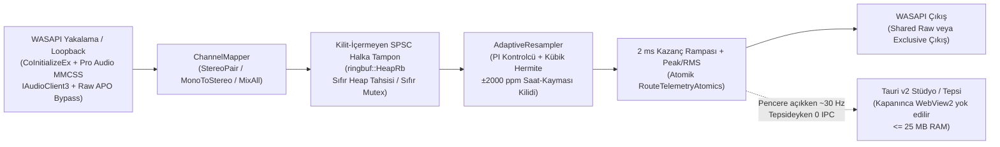

<p align="center">
  <picture>
    <source media="(prefers-color-scheme: dark)" srcset="./brand/uncord-lockup-dark.svg">
    <source media="(prefers-color-scheme: light)" srcset="./brand/uncord-lockup-color.svg">
    
  </picture>
</p>

# uncord

**Kullanıcı alanında çalışan Windows WASAPI çoklu ses yönlendiricisi (`<= 12 ms` yazılım gecikmesi, `<= 25 MB` tepsi belleği).**

Yakalama girişlerini, çok kanallı USB-C arayüzlerini ve WASAPI loopback uç noktalarını adaptif saat-kayması yeniden örnekleyicisiyle bir veya daha fazla çıkışa bağlar; başsız CLI içerir.

[](LICENSE)
[](#hızlı-başlangıç)
[](#gecikme-dağılımı-yazılım-hattı-ve-fiziksel-iletim)
[](#temel-mimari)

[English](./README.md) | Türkçe · [Ajan Mimari Kılavuzu](./AGENTS.md) · [Marka Kılavuzu](./brand/BRAND_GUIDELINES.md) · [Sürüm Geçmişi](./CHANGELOG.md)

---

## Neden uncord?

Windows'un yerleşik **"Bu aygıtı dinle"** seçeneği kanal ayrıştırmayı desteklemez, gecikme kontrolü sunmaz, bağımsız iki donanım saati arasında zamanla kayma (drift) yaşar ve tek bir gizli tampon boyutuna mahkûm eder. Tam kapsamlı DAW yazılımları veya çekirdek tabanlı sanal kablolar ise basit yönlendirmeler için ağır kurulum ve sürekli CPU/RAM yükü getirir.

`uncord`, canlı yakalama kaynaklarını ve WASAPI loopback uç noktalarını kullanıcı alanında doğrudan bir veya daha fazla çıkış aygıtına bağlar:

| Yetenek | Windows "Bu aygıtı dinle" | Sanal Kablo + DAW | `uncord` |
| :--- | :--- | :--- | :--- |
| **Yazılım Hattı Gecikmesi** | Yüksek, gizli OS tamponlaması | ASIO/DAW zincirine bağlı | **`<= 12.0 ms`** (`UltraLow` shared/exclusive WASAPI) |
| **4 Kanallı USB-C Ayırma** | Kanalları birleştirir veya düşürür | Oturum başına manuel kanal atama | **Yerleşik `StereoPair` / `MonoToStereo` / `MixAll`** |
| **Çift Saat Kayması Kontrolü** | Zamanla çıtırtı ve kesilme | ASIO4ALL / manuel eşitleme gerekir | **PI Kübik Hermite Adaptif Resampler (`±2000 ppm`)** |
| **Bluetooth HFP Tespiti** | Sessizce 8–16 kHz monoya düşer | Manuel uç nokta kontrolü | **Otomatik `isBluetoothHfpWarning` Uyarısı** |
| **Sistem Loopback Karıştırma** | Desteklenmez | Sanal kablo sürücüsü gerekir | **Doğal WASAPI Loopback Hatları** |
| **Arka Plan Tepsi Belleği** | OS Ses Denetim Masası | 150–400+ MB DAW/Electron süreci | **`<= 25 MB` RAM** (`window.destroy()` WebView2'yi kapatır) |
| **Headless Otomasyon** | Yalnızca GUI denetim masası | GUI zorunlu | **`uncord-cli --headless` ve Kayıtlı Profiller** |

---

## Çok Kanallı USB-C Arayüzler (Blackstar ID:Core V4 ve Benzerleri)

Modern USB-C gitar amfilerinin ve ses kartlarının çoğu —örneğin **Blackstar ID:Core V4**— tek bir sınıf uyumlu (class-compliant) USB ses akışı üzerinden **4 yakalama kanalı** sunar:

- **Kanal 1–2 (`StereoPair { left: 0, right: 1 }`)**: İşlenmiş stereo amfi tonu (preamp, kabin simülasyonu, stereo efektler). Günlük çalışma için bu çifti doğrudan kablolu stüdyo monitörlerinize, kulaklığınıza veya Bluetooth A2DP kulaklığa yönlendirin.
- **Kanal 3–4 (`StereoPair { left: 2, right: 3 }`) ve Kanal 4 (`MonoToStereo { channel: 3 }`)**: İşlenmemiş kuru DI / reamp sinyali. Tek bir mono DI kanalını sol ve sağ çıkışlara eşit ortalamak için `--channels mono:4` (veya masaüstü stüdyoda `Ch 4 Dry DI -> Stereo`) seçin; tüm giriş kanallarını toplamak için `--channels all` (`MixAllToStereo`) kullanın.
- **Paralel Loopback Altyapı Karıştırma (`--loopback`)**: Enstrüman hattınızın yanına masaüstü çıkış loopback uç noktasından ikinci bir hat ekleyerek tarayıcıdaki dersleri veya altyapı parçalarını bağımsız kazanç (gain) ve sessize alma (mute) kontrolüyle birlikte dinleyin.

---

## Gecikme Dağılımı: Yazılım Hattı ve Fiziksel İletim

Yazılım yönlendirmesi, kablosuz radyo veya Bluetooth kodek kaynaklı fiziksel gecikmeyi ortadan kaldıramaz. `uncord`, `UltraLow` modunda kendi **yazılım hattı gecikmesini** (yakalama periyodu + SPSC halka tampon + çıkış periyodu) `<= 12.0 ms` altında tutar ve donanımın tahmini fiziksel iletim tabanını canlı telemetride (`LatencyBreakdown`) ayrı olarak raporlar.

| Çıkış İletimi | Yazılım Hattı (`uncord`) | Tahmini Fiziksel İletim Tabanı | Tipik Toplam Uçtan Uca Gecikme | Önerilen Kullanım |
| :--- | :--- | :--- | :--- | :--- |
| **Kablolu / USB Doğrudan (Raw / Exclusive)** | `<= 12.0 ms` (`~4–8 ms` `UltraLow`) | `~0–2 ms` | **`~5–14 ms`** | Canlı gitar/vokal monitörleme ve hassas çalışma |
| **2.4 GHz Düşük Gecikmeli Dongle** | `<= 12.0 ms` | `~15–25 ms` | `~20–37 ms` | Düşük gecikmeli kablosuz dinleme ve masaüstü ses |
| **Bluetooth A2DP (Stereo Çalma)** | `<= 12.0 ms` | `~120–250 ms` (Windows SBC/AAC yığını) | `~130–265 ms` | Altyapı dinleme, günlük kullanım, medya yönlendirme |
| **Bluetooth HFP / Hands-Free (`⚠`)** | `<= 12.0 ms` | `~250–400 ms` (8–16 kHz mono SCO) | `~260–415 ms` | Yalnızca arama profili — `uncord` kalıcı uyarı göstererek Stereo A2DP uç noktasına geçmenizi sağlar |

### Gecikme Önayarları (`LatencyMode`)

| Mod | CLI Bayrağı | Hedef Halka Tamponu | En Uygun Senaryo |
| :--- | :--- | :--- | :--- |
| `UltraLow` | `--latency ultra-low` | `~4 ms` | `IAudioClient3` en küçük periyodu ve Raw APO atlaması ile kablolu/USB izleme |
| `Low` | `--latency low` | `~8 ms` | Dengeli düşük gecikmeli USB / 2.4 GHz oturumları |
| `Balanced` | `--latency balanced` | `~16 ms` | Karma USB-Bluetooth yönlendirmeleri veya yoğun sistemler |
| `Safe` | `--latency safe` | `~32 ms` | Yüksek titreşimli (jitter) kablosuz sürücüler veya güç tasarruflu dizüstü bilgisayarlar |

---

## Temel Mimari



1. **Sıfır Tahsisatlı Gerçek Zamanlı Sıcak Yol (`crates/uncord-core`)**
   Yakalama ve çıkış iş parçacıkları COM ortamını (`COINIT_MULTITHREADED`) başlatır, Windows MMCSS (`AvSetMmThreadCharacteristicsW("Pro Audio")`) ile gerçek zamanlı öncelik alır ve yalnızca önceden ayrılmış kilit-içermeyen SPSC `ringbuf::HeapRb<f32>` ile atomik telemetri sayaçları (`RouteTelemetryAtomics`) üzerinden haberleşir. Ses geri çağrılarında bellek tahsisatı, mutex kilidi veya engelleyici I/O yapılmaz.
2. **Adaptif Kristal Saat-Kayması Resampler (`AdaptiveResampler`)**
   Bir fiziksel aygıttan (ör. 48 kHz USB amfi) farklı bir saat kristaline sahip başka bir aygıta (ör. 44.1 kHz veya 48 kHz Bluetooth kulaklık) yönlendirme yapılırken donanım saatleri zamanla ayrışır. Oransal-integral (PI) denetleyici SPSC tampon doluluk oranını seçili `LatencyMode` hedefine göre izler ve kesirli kübik Hermite resampler oranını `±2000 ppm` aralığında sürekli ayarlayarak canlı `driftPpm` ve `xruns` metriklerini çıtırtısız dengeler.
3. **WebView2 Olmayan Tepsi Bellek İzi (`src-tauri`)**
   Masaüstü penceresi kapatıldığında uygulama sistem tepsisine çekilir ve WebView2 render sürecini tamamen sonlandırmak için `window.destroy()` çağrılır; pencere tekrar açılana kadar arayüz telemetri yayını durdurulur. Arka planda yalnızca Rust ses motoru ve sistem tepsisi kalır (`<= 25 MB` RAM).

---

## Hızlı Başlangıç

### 1. Masaüstü Uygulaması (`uncord.exe`)

[GitHub Releases](https://github.com/Woffluon/uncord/releases) üzerinden `uncord-v<version>-windows-x64-portable.zip` paketini veya NSIS kurulum dosyasını indirin:

```powershell
# Masaüstü penceresini başlat
.\uncord.exe

# Doğrudan Windows sistem tepsisinde başlat (başlangıçta WebView2 penceresi oluşturulmaz)
.\uncord.exe --start-minimized
```

Tepsi menüsü **Show / Hide uncord**, **Quick Mute All**, **Profiles** geçişi ve `UncordEngine::shutdown()` çağrısı yapan **Quit uncord** seçeneklerini içerir.

### 2. Başsız CLI (`uncord-cli.exe`)

Arayüz penceresi açmadan PowerShell, Görev Zamanlayıcı veya betikler üzerinden arka plan yönlendirmelerini çalıştırın:

```powershell
# Etkin yakalama, çıkış ve loopback uç noktalarını listele
uncord-cli --list-devices
uncord-cli --list-devices --json

# %APPDATA%\uncord\config.json içindeki kayıtlı bir profili çalıştır
uncord-cli --headless --profile "Practice"

# Blackstar USB-C Kanal 1-2 sinyalini Bluetooth A2DP stereo kulaklığa yönlendir
uncord-cli --headless --source "Blackstar" --target "WH-1000XM5 Stereo" --channels 1-2 --latency ultra-low --gain-db 0.0

# Blackstar Kanal 4 kuru DI sinyalini exclusive modda kablolu stüdyo monitörlerine stereo-ortalı yönlendir
uncord-cli --headless --source "Blackstar" --target "Studio Monitors" --channels mono:4 --exclusive --latency ultra-low

# Sistem sesini WASAPI loopback üzerinden yönlendir
uncord-cli --headless --source "Speakers" --target "Studio Monitors" --loopback --latency low
```

#### CLI Bayrakları

| Bayrak | Açıklama | Varsayılan |
| :--- | :--- | :--- |
| `--list-devices` | Etkin yakalama, çıkış ve loopback uç noktalarını listeler | |
| `--json` | `--list-devices` çıktısını JSON biçiminde yazdırır | Kapalı |
| `--headless` | `Ctrl-C` sinyaline kadar terminalde ses yönlendirmeyi sürdürür | |
| `--profile <ad>` | Kayıtlı bir profildeki tüm etkin hatları yükleyip başlatır | |
| `--source <id-veya-parça>` | Kaynak aygıt kimliği veya büyük/küçük harf duyarsız ad parçası | |
| `--target <id-veya-parça>` | Hedef çıkış aygıtı kimliği veya ad parçası | |
| `--channels <biçim>` | Kanal seçimi: `1-2`, `3-4`, `mono:<n>` veya `all` | `1-2` |
| `--gain-db <sayı>` | dB cinsinden hat çıkış kazancı (`<= -59.5` sessizliğe çeker) | `0.0` |
| `--loopback` | Çıkış uç noktasından WASAPI loopback ile yakalama yapar | Kapalı |
| `--exclusive` | Hedef aygıtta `AUDCLNT_SHAREMODE_EXCLUSIVE` ister | Kapalı |
| `--latency <mod>` | Tampon önayarı: `ultra-low`, `low`, `balanced` veya `safe` | `ultra-low` |
| `-V`, `--version` | `uncord-cli` sürüm numarasını gösterir | |

---

## Derleme, Benchmark ve Sürüm Doğrulaması

### Yerel Derleme ve Testler

```powershell
# Önyüz bağımlılıklarını kurun
pnpm install

# React 19 arayüzünü tip denetiminden geçirip derleyin
pnpm typecheck
pnpm build

# Rust çalışma alanı birim ve entegrasyon testlerini çalıştırın (deterministik MockAudioBackend kullanır)
cargo test --workspace

# 5 saniyelik saat-kayması ve yazılım gecikmesi benchmark testini çalıştırın (<= 12.0 ms, 0 xrun)
cargo test -p uncord-core --release -- --nocapture bench_pipeline_latency_and_drift

# Sıfır Clippy uyarısını doğrulayın
cargo clippy --workspace -- -D warnings

# Windows masaüstü uygulamasını ve NSIS kurucusunu derleyin
pnpm tauri build
```

### Sürüm Eşitleme, Dokümantasyon Kapısı ve Sürüm Paketleme

```powershell
# package.json, Cargo.toml, tauri.conf.json ve uncord-core arasındaki Conventional Commit sürüm kurallarını test edin
powershell -File scripts/test-versioning.ps1

# Çift dilli README simetrisini ve marka/ikon varlık kontrollerini test edin
powershell -File scripts/test-verify-docs.ps1

# Commit öncesinde sürüm eşitliğini ve dokümantasyon uyumunu denetleyin
powershell -File scripts/validate-version.ps1 -Message "feat: add route preset hotkey"
powershell -File scripts/verify-docs.ps1

# artifacts/ altına taşınabilir zip, varsa NSIS kurucusu ve SHA-256 sağlama toplamlarını hazırlayın
powershell -File scripts/stage-release.ps1
```

---

## Otomatik Güncelleme ve Doğrulama Politikası

Windows masaüstü uygulaması (`uncord.exe`), açılıştan sonra `https://github.com/Woffluon/uncord/releases/latest/download/latest.json` ve `latest.json.sig` dosyalarını kontrol eder (Ayarlar -> `Auto-check updates` anahtarından kapatılabilir veya elle tetiklenebilir).

Her güncelleme denetimi ve indirmesi şu kontrolleri uygular:
1. **Önce Ed25519 imza doğrulaması:** `latest.json` dosyası JSON ayrıştırmasından önce [`assets/update-public-key.hex`](./assets/update-public-key.hex) içindeki sabitlenmiş Ed25519 açık anahtarıyla doğrulanır (`UPDATE_MANIFEST_PRIVATE_KEY_BASE64` yalnızca GitHub Actions gizli değişkeninde tutulur).
2. **Sıkı HTTPS izin listesi:** Bildirim, imza ve kurucu indirmeleri yalnızca `github.com/Woffluon/uncord/*` ve GitHub sürüm barındırma adreslerine (`objects.githubusercontent.com`, `release-assets.githubusercontent.com`) izin verir; izin listesi dışındaki yönlendirmeleri engeller.
3. **SHA-256 ve Windows PE doğrulaması:** NSIS kurucusu (`uncord_<sürüm>_x64-setup.exe`) `%LOCALAPPDATA%\uncord\Updates\` dizinine atomik olarak indirilir, imzalı SHA-256 özeti ve Win32 `FileVersion` kaynağı (`major.minor.patch`) doğrulandıktan sonra salt-okunur kilitle başlatılır.

---

## Lisans

[MIT Lisansı](./LICENSE) kapsamında yayınlanmıştır.
